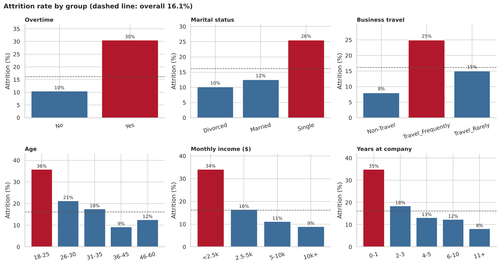
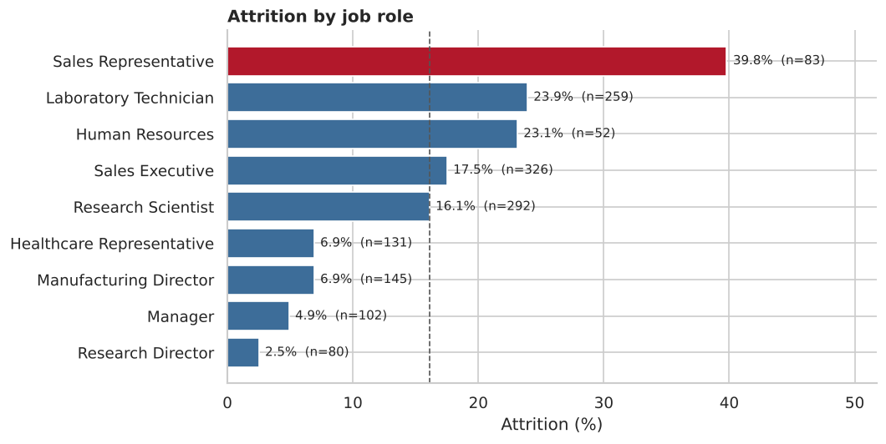
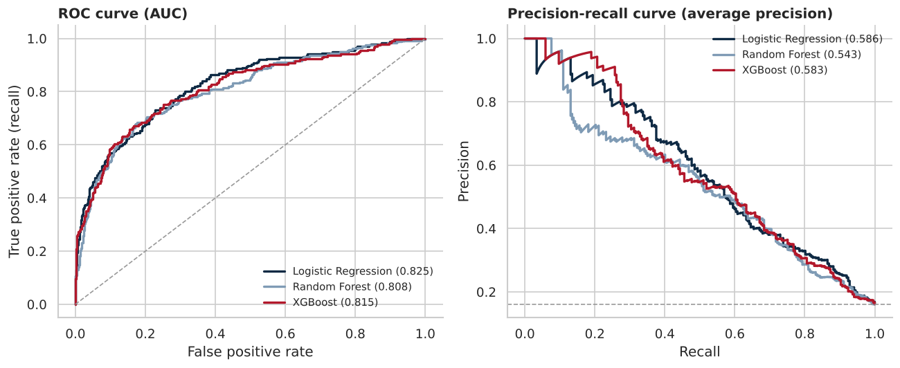
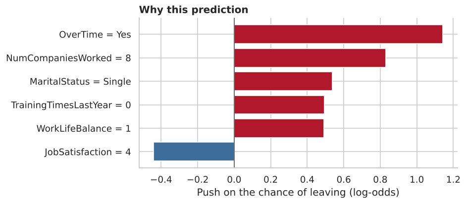

# Employee Attrition Prediction

Finds what drives employees to leave and scores each employee's risk of leaving with an explanation of the score. Built on the IBM HR Analytics dataset (1,470 employees), comparing Logistic Regression, Random Forest and XGBoost with stratified cross-validation.

**Live demo:** https://mq-employee-attrition-prediction.streamlit.app/



## Problem

Replacing an employee costs recruiting, training and lost output. HR teams need to know who is likely to leave and why, early enough to act. This project answers:

1. Which factors are linked to attrition?
2. How well can a model rank employees by their risk of leaving?
3. For one employee, what is pushing the risk up or down?

## Dataset

[IBM HR Analytics Employee Attrition & Performance](https://www.kaggle.com/datasets/pavansubhasht/ibm-hr-analytics-attrition-dataset) on Kaggle, saved as `data/ibm_hr_attrition.csv`. It is a fictional dataset created by IBM data scientists: 1,470 employees and 35 columns covering demographics, role, pay, tenure, travel, overtime and satisfaction scores. The target is `Attrition` (Yes/No).

## Data checks

- No missing values or duplicate rows.
- `EmployeeCount`, `StandardHours` and `Over18` have a single value and are dropped.
- `EmployeeNumber` is an ID and is not used as an input.
- **16.1% of employees left.** Because of this imbalance, a model that always predicts "stays" is 83.9% accurate, so accuracy is not used to pick a model.

## Key findings

| Group | Attrition |
|---|---|
| Works overtime | 30.5% (vs 10.4% without) |
| Sales representatives | 39.8% |
| Age 18 to 25 | 35.8% |
| First year at the company | 34.9% |
| Monthly income under $2,500 | 34.1% |
| Single | 25.5% (vs 10.1% divorced) |
| Travels frequently | 24.9% (vs 8.0% non-travel) |
| Research directors | 2.5% |

- Leavers earn a median of $3,202 a month against $5,204 for those who stayed (Mann-Whitney U test, p < 0.001).
- Low job involvement, low job, environment and work-life satisfaction, and no stock options all raise attrition.
- Gender, education, relationship satisfaction and performance rating show no significant link (chi-square p > 0.05).



## Model

All preprocessing (one-hot encoding, scaling) runs inside scikit-learn pipelines, so it is fitted on training folds only. Class imbalance is handled with balanced class weights (`scale_pos_weight` for XGBoost). Scores come from stratified 5-fold cross-validation, so every employee is scored by a model that never saw them.

| Model | ROC-AUC | PR-AUC | Recall | Precision | Accuracy |
|---|---|---|---|---|---|
| Always predict "stays" | 0.500 | 0.161 | 0.000 | 0.000 | 0.839 |
| **Logistic Regression** | **0.825** | **0.586** | **0.738** | 0.368 | 0.753 |
| Random Forest | 0.808 | 0.543 | 0.511 | 0.531 | 0.848 |
| XGBoost | 0.815 | 0.583 | 0.595 | 0.515 | 0.844 |

Logistic Regression ranks risk best and its scores can be split exactly into each input's contribution, so it is the final model. XGBoost is close behind.



### Threshold

| Threshold | Employees flagged | Leavers caught (of 237) | Precision |
|---|---|---|---|
| 0.3 | 736 | 207 | 0.28 |
| 0.5 | 476 | 175 | 0.37 |
| 0.7 | 238 | 128 | 0.54 |

A team with limited time for retention conversations can raise the threshold to focus on the highest-risk employees.

### Drivers learned by the model

Overtime has the largest effect: holding other inputs fixed, it multiplies the odds of leaving by about 4.9. Frequent travel, laboratory technician and sales representative roles, being single and years since last promotion also raise risk, while being a research director, not travelling and longer time with the current manager lower it.

### Explaining one employee

For each employee, the app shows how much each input moves the score compared with the average employee. For a linear model this is exact: coefficient x (employee's value - average value).



### Fixes from the first version

- The first version trained models on raw values and then tested them on standardized values (the test set was overwritten for the SVM). That made Logistic Regression, Decision Tree and Random Forest look broken, with accuracy as low as 0.16 to 0.54 and ROC-AUC 0.65. The notebook reproduces this.
- It used `EmployeeNumber` as a feature and the model ranked it in its top ten.
- It chose models by accuracy, which an "always stays" model beats.
- It scaled the full dataset before splitting.

## Recommendations

- Review overtime load, especially in sales and laboratory roles.
- Give extra support and check-ins in an employee's first year.
- Review pay for the lowest income band.
- Use the risk list to start retention conversations before people resign.

## Web app

- **Score an employee:** pick an employee from the dataset or enter your own values, and see the risk score with a chart of what drives it
- **What drives attrition:** attrition by group, role, satisfaction and income, with statistical tests
- **Model:** model comparison, threshold trade-offs and the model's main drivers
- **Data:** data checks and the full dataset

## Tech stack

Python, Pandas, NumPy, Matplotlib, Seaborn, SciPy, scikit-learn, XGBoost, Streamlit, Jupyter Notebook

## Project structure

```
employee-attrition-prediction/
├── app.py                          Streamlit app
├── data/
│   └── ibm_hr_attrition.csv        IBM HR dataset
├── notebooks/
│   └── employee_attrition.ipynb    Analysis, modeling and findings
├── reports/
│   ├── figures/                    Charts exported by the notebook
│   ├── attrition_drivers.csv
│   ├── model_comparison.csv
│   └── logistic_coefficients.csv
├── src/
│   ├── analysis.py                 Loading, summaries, tests and charts
│   └── model.py                    Pipelines, evaluation, thresholds and explanations
├── requirements.txt
└── README.md
```

## Run locally

```bash
git clone https://github.com/Qasim00760/employee-attrition-prediction.git
cd employee-attrition-prediction
pip install -r requirements.txt
streamlit run app.py
```

To run the notebook:

```bash
pip install notebook
jupyter notebook notebooks/employee_attrition.ipynb
```

## Author

Muhammad Qasim
[Portfolio](https://qasim.devsil.com) | [LinkedIn](https://www.linkedin.com/in/muhammad-qasim-1944b8349) | [GitHub](https://github.com/Qasim00760)
